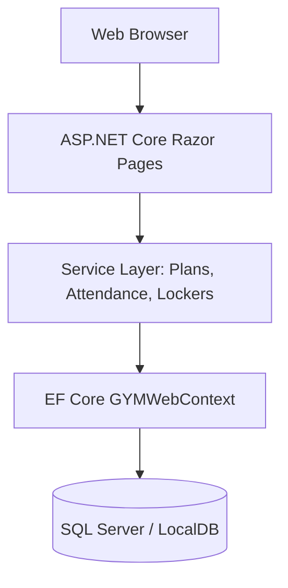

# GYMWeb System Architecture & Design

## Layers
1. **Presentation**: ASP.NET Core Razor Pages (`Pages/Action/`, `Pages/Members/`, `Pages/Employees/`, `Pages/Admins/`).
2. **Business Services**: Enforces membership durations, attendance logs, and locker rentals.
3. **Data Layer**: Entity Framework Core DbContext mapping Code-First domain models.
